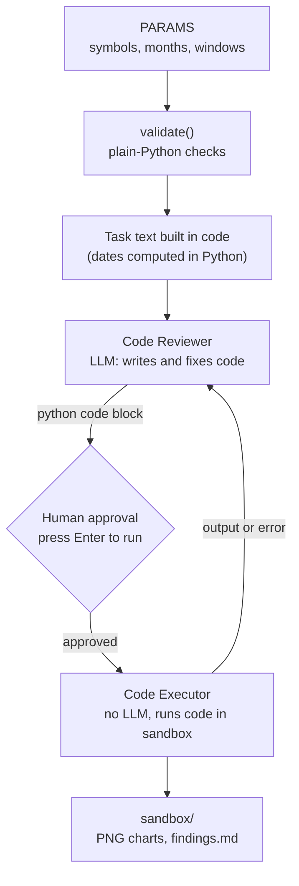

<div align="center">

# AI Coding Agent

**A two-agent system that writes, runs and reviews Python code to analyze market data, with a human approving every step.**


[Overview](#overview) · [How it works](#how-it-works) · [Getting started](#getting-started) · [Configuration](#configuration) · [Safety](#safety-model) · [Limitations](#limitations)

</div>

---

> **Status: experimental learning project.** It executes model-written code on your machine. Read every code block before you approve it, and read the [Safety model](#safety-model) first.

## Overview

This project explores a common agent pattern: one agent **thinks** and one agent **acts**.

- The **code reviewer** (a Gemini model) writes Python, reads the output of each run, and fixes problems.
- The **code executor** (no model at all) only runs the code it receives, in an isolated folder and virtual environment, after a human approves it.

The default task downloads daily closing prices for BTC-USD and NVDA, computes short and long simple moving averages, normalizes both assets to a common base of 100, detects moving-average crossovers, and saves charts and a findings file.

Task settings (symbols, time window, moving-average lengths) are plain Python parameters that are validated in code before any model is called.

## How it works



### Agents

| Agent | Has a model | Role |
|---|---|---|
| **code_reviewer** | Yes (Gemini) | Writes one code block per reply, reviews execution output, fixes errors |
| **code_executor** | No | Runs approved code blocks inside the sandbox folder and virtual environment |

### What the default task produces

| File | Contents |
|---|---|
| `price_and_sma.png` | Price with short and long moving averages, one panel per symbol |
| `normalized_sma.png` | Short moving averages rebased to 100 on the first shared date |
| `findings.md` | Printed numbers, last data date, download time (UTC), and limitations |

## Getting started

### Prerequisites

- Python 3.10 or newer
- A Google AI Studio API key for the Gemini API

### Installation

```bash
git clone https://github.com/laywright/ai-coding-agent.git
cd ai-coding-agent

python -m venv .venv
```

Activate the virtual environment:

| Shell | Command |
|---|---|
| Windows (Command Prompt) | `.venv\Scripts\activate.bat` |
| Windows (PowerShell) | `.venv\Scripts\Activate.ps1` |
| macOS / Linux | `source .venv/bin/activate` |

Install the dependency:

```bash
pip install "autogen[gemini]"
```

### API key

The key is read from the `GEMINI_API_KEY` environment variable. Never put it in the code or commit it.

| Shell | Command |
|---|---|
| Windows (Command Prompt) | `set GEMINI_API_KEY=your-key-here` |
| Windows (PowerShell) | `$env:GEMINI_API_KEY="your-key-here"` |
| macOS / Linux | `export GEMINI_API_KEY="your-key-here"` |

The variable lasts only for the current terminal session. Do not paste commands containing your key into chats, issues or screenshots.

### Run

```bash
python ai_coding_agent.py
```

The first start is slow because the sandbox virtual environment is created. When the executor shows a code block and asks for input, **read the code**, then press **Enter** to run it. Typing text sends it to the reviewer as feedback instead of running the code.

Generated files appear in the `sandbox/` folder.

## Configuration

Edit the `PARAMS` dictionary at the top of `ai_coding_agent.py`:

```python
PARAMS = {
    "symbols": ["BTC-USD", "NVDA"],   # Yahoo Finance tickers
    "months": 4,
    "short_window": 7,
    "long_window": 30,
    "normalize": True,                # rebase to 100 and plot together
}
```

| Parameter | Meaning | Validated rule |
|---|---|---|
| `symbols` | Tickers to analyze | 1 to 4 symbols, from the allowed set |
| `months` | History length | 1 to 24 |
| `short_window` / `long_window` | Moving-average lengths | `2 <= short < long <= 200`, and enough history for `long` |
| `normalize` | Adds the rebased comparison chart | `True` or `False` |

Invalid settings stop the program with a clear message before any model is called. The allowed ticker set is `ALLOWED_SYMBOLS` in the same file.

## Safety model

This tool runs code written by a language model. Treat it accordingly.

- **Human approval is the main control.** The executor runs with `human_input_mode="ALWAYS"`, so nothing executes until you press Enter.
- **Generated code runs on your machine** with your user permissions and can likely read your environment variables, including the API key. Read each block first.
- **Installs go into a separate sandbox virtual environment** (`sandbox_venv/`), not your project environment. The reviewer is told to install only `pandas`, `numpy`, `matplotlib` and `yfinance`. That limit is a prompt instruction, not a technical enforcement, so check the package names in each install block before approving.
- **Network use** is meant to be limited to package installation and price downloads. This is also a prompt instruction.
- **Parameters are validated in plain Python,** and the task dates are computed in code rather than left to the model.
- For anything beyond experimentation, run the executor inside a container such as Docker so generated code cannot reach your files.

## Project structure

```
ai-coding-agent/
├── ai_coding_agent.py   # agents, parameter validation, task builder, runner
├── README.md
├── LICENSE
└── .gitignore
```

`sandbox/` and `sandbox_venv/` are created at runtime and are git-ignored.

## Limitations

- **Model claims are not evidence.** The reviewer can describe results it has not seen. Judge the run by the actual execution output and the files produced.
- **Not a trading tool.** Moving-average crossovers describe past prices. Nothing here predicts prices or gives financial advice.
- **Data source.** Prices come from `yfinance`, an unofficial library that can break, be rate-limited or return delayed data. Check the data provider's terms before relying on it.
- **Different trading calendars.** Bitcoin trades every day, while NVIDIA trades only on exchange days, so aligning them involves trade-offs that affect the results.
- **Non-deterministic output.** Different runs can produce different code and different results.
- **No automated evaluation yet.** There are no tests that check the agent's numbers against an independent calculation.
- **Server load.** The Gemini API can return temporary 503 errors. The script retries a few times with increasing waits.

## Built with

- [AutoGen / AG2](https://github.com/ag2ai/ag2) for the agent framework
- Google Gemini via the Gemini API
- [yfinance](https://github.com/ranaroussi/yfinance), pandas, NumPy and Matplotlib inside the sandbox

## License

Released under the [MIT License](LICENSE).

## Author

**Alex Ngechu Muiruri** · [GitHub](https://github.com/laywright)
